# Herkunftskarte XenSonar

**Stand:** 09.11.2026. **Autoritative Runtime:** `main`, `index.html` SHA-256 `aec64584fb7a98e70b1c2e80286007b8f7f509db410c53d914e2d0ffeb5f5961` (Commit `3d338f5`, LIVEPATH-02 + Quellbaum 2a/2c). Alle älteren Stände sind nur Referenz.
**Art der Belege:** statische Textbelege. Keine Source-Maps, keine Aussagen über Laufzeitverhalten.

## 1. Weg des Codes

```mermaid
flowchart LR
  TS["Sept. 2026<br/>TypeScript/React 400.2<br/>1 328 Produktdateien<br/><i>Zweig reference/ts-400.2</i>"]
  BUILD["Vite-Build<br/>minifizierter Kern<br/><i>Artefakt nicht überliefert</i>"]
  E3["E3 modulare Quelle<br/>228 Hauptmodule<br/><i>nicht überliefert, nur im Bericht</i>"]
  O26["26.10. UI3-Stand<br/>Concat-Build, Manifest"]
  O28["28.10. Gesamtmerge<br/>305 Dateien, 205 Tests"]
  N05["05.11. Stage05<br/>Testkandidat"]
  W31["08.11. W31<br/>Handoff e4fc…"]
  MAIN["09.11. main<br/>375 Dateien<br/>Oktober-Grenzen"]
  TS -- "kompiliert (belegt: Literale, Namen)" --> BUILD
  BUILD -. "zerlegt in 228 Module (Bericht, rekonstruiert)" .-> E3
  E3 -. "Stammbaum A/B/C unbewiesen" .-> O26
  O26 -- "237 Dateien gleich, 51 geändert, 17 neu" --> O28
  O28 -- "direkte HTML-Patches" --> N05
  N05 -- "direkte HTML-Patches" --> W31
  W31 -- "DUB-ECHO-04, LIVEPATH-01/02, 6 Dateien" --> MAIN
```



Durchgezogen = durch Textvergleich belegt. Gestrichelt = nur durch historische Berichte belegt (`README_META_RECONSTRUCTION.md`, `RECONSTRUCTION_REPORT.json`: 228 Hauptmodule, 224 Schnitte auf identischen Zeilen, 3 per Zeichenabgleich; ausdrücklich „recovered view, not proof of a common git ancestor").

**Kernbefund:** Der minifizierte React-Kern wurde **einmal kompiliert und seitdem nur noch direkt gepatcht**. Beleg: Die minifizierten Namen sind über alle Wegpunkte stabil (Beispiel `tEe` unten). Ein Neu-Build aus TypeScript hätte sie verändert.

## 2. Jede Quelldatei in `main` (`FILE_PROVENANCE.json`)

| Kategorie | Dateien | Bedeutung |
|---|---|---|
| `ERHALTEN_OKT_IDENTISCH` | 200 | Text identisch mit dem Oktober-Modul gleichen Namens |
| `VERAENDERT_OKT_MODUL` | 97 | Oktober-Modul, im Inneren weiterentwickelt; Grenzen und Name erhalten |
| `NEU_NACH_OKT_BLOCK` | 43 | eigener Block, nach dem 28.10. entstanden (z. B. Wave Editor, Melodic-Speicher) |
| `NEU_NACH_OKT_EINSCHUB` | 29 | zwischen Oktober-Dateien eingefügter Code |
| `GEAENDERT_NACH_UEBERGABE` | 6 | seit W31 geändert (DUB-ECHO-04, LIVEPATH-01/02); deckt sich exakt mit den Commits |
| `HERKUNFT_UNBEKANNT` | 0 | |

**Seit wann unverändert** (voller Dateitext wörtlich im Wegpunkt):

| unverändert seit | Dateien |
|---|---|
| 26.10. | 188 |
| 28.10. | 16 |
| 05.11. | 80 |
| 08.11. (W31) | 85 |
| nach Übergabe geändert | 6 |

Pro Datei stehen außerdem die Anweisungs-Ähnlichkeit zu jedem Wegpunkt und die TypeScript-Kandidaten in der JSON-Datei.

**Verschobene Verantwortlichkeiten:**
- Zwischen 26.10. und 28.10. wurden keine Module entfernt. 51 wurden geändert, 17 kamen hinzu (u. a. `audio/avalanche.js`, `audio/hold_modulation.js`, `forge/analysis/06_polyphonic_transfer.js`, Header-/Shell-Zusätze).
- 15 TypeScript-Dateien verteilen sich heute auf mehrere Quelldateien (Feld `ts_files_spread_over_several_current_files`).
- `src/rhythm/06_lane_pan.js` (Oktober) fehlt; seine Rolle hat vermutlich `__XenPan` übernommen (`unverified`).

## 3. TypeScript-Herkunft (`../TS_ORIGIN_MAP.json`, `PROVENANCE_MATCHES.json`)

- 47 Quelldateien in `main` ↔ 248 TypeScript-Dateien über eindeutige Zeichenketten (≥ 16 Zeichen, genau einmal im Code).
- GPTs `evidence_probe.py` (≥ 32 Zeichen, eindeutig im TS-Baum): 295 TS-Dateien mit Treffern; 196 Oktober-Module ≥ 120 B wörtlich, 100 mit Ankertreffern.
- Beweisgrad durchgehend `LITERAL_MATCH_ONLY_NOT_MODULE_IDENTITY`: Orientierung, keine Modulidentität.
- Ähnlichkeitszahlen auf Dateiebene (z. B. „`App.tsx` 10 %") sind **kein** Maß für verlorene Architektur. Minifizierung, Aufteilung auf mehrere Dateien und spätere Patches verwischen Zeichenketten.

## 4. Beispiel-Spur: Metronom-Puls

| Stand | Ort | Beleg |
|---|---|---|
| Sept. 400.2 | `src/features/xensonar/rooms/useStableRhythmMetronomePulse.ts` (SHA-256 `82e999cb…`) | Quelltext |
| Vite-Build | minifiziert als `function tEe()` | Struktur 1:1 (useState/useRef/useCallback, `step16%4`, setTimeout) |
| 26.10. / 28.10. / 05.11. / W31 | `function tEe(){const[e,t]=P.useState(0),…` | wörtlich gleicher Fingerabdruck, gleicher Name in allen vier Wegpunkten |
| `main` | `src/rhythm/04_workspace_and_transport.js` | LIVEPATH-02 (Commit `c076bde`): Puls ist No-op, weil `metronomePulse` von keiner Komponente gelesen wird |

## 5. Regeln für die Nutzung
- Für die Arbeit an einem Bereich: in `FILE_PROVENANCE.json` nachsehen, aus welchen TS-Dateien er stammt, und dort Namen, Typen und Kommentare lesen (Zweig `reference/ts-400.2`). **Kein** alter Code wird ungeprüft übernommen.
- Rückführung eines Bereichs nach TypeScript ist eine eigene fachliche Migration mit Audio-, PCM-, Speicher- und UI-Parität und Rollback.

## 6. Neu erzeugen
```
git worktree add ../wp reference/waypoints
python3 tools/analysis/provenance.py ../wp [oct26/source-manifest.json oct28/source-manifest.json]
git worktree add ../ts reference/ts-400.2
python3 tools/analysis/ts_origin_map.py ../ts
python3 tools/analysis/evidence_probe.py --runtime index.html --oct-zip <Oktober-ZIP> --ts-zip <400.2-ZIP> --out docs/provenance/PROVENANCE_MATCHES.json
```
Herkunft der Wegpunkte und Hashes: Zweig `reference/waypoints`. Oktober-Manifeste: Quellbaum-Nachtrag und Provenienzbrücke (Pakete vom 09.11.2026).
